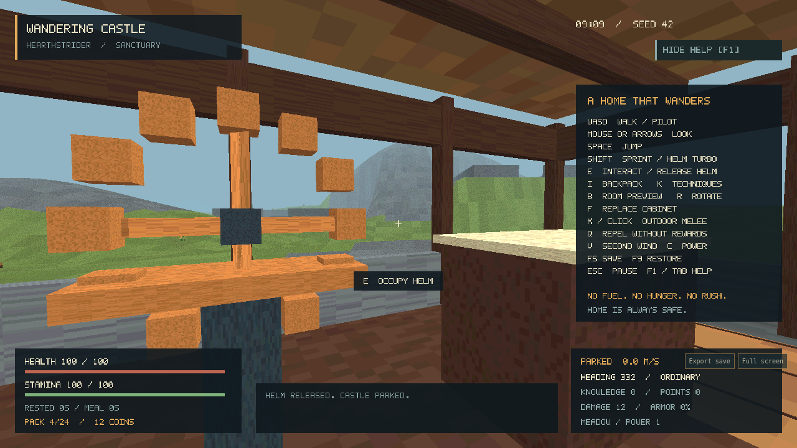

# Wandering Castle

A first-person home on six legs. Plant a garden, follow a ridge, park the
Hearthstrider, and bring something useful home.

**First playable release, 0.1.0.** C17, SDL3, OpenGL and external Lua content.
The peaceful crafting / expansion / gardening / foundry / homecoming journey
runs on Linux and in a browser. The full production brief remains the target;
[verification and remaining gaps](docs/verification.md) distinguish implemented
features, automated evidence and pending human/device acceptance.



## Run

Keep `assets/` beside the executable. On Linux, extract the native package and
run `./wandering`. Choose **Begin wandering**. Optional: `./wandering --seed 42`.

For the web package, serve its directory:

```sh
python3 -m http.server 8088 --directory dist/wandering-web
```

Open `http://localhost:8088/wandering.html`. Add `?seed=42` for a reproducible
world. Mobile browsers show touch controls automatically. WebXR requires a
compatible browser/headset and HTTPS or localhost; **Enter WebXR** appears when
immersive VR is supported. Stick to move, trigger to interact/select, squeeze
to cycle panel buttons. Headset acceptance is pending.

## Build

Requires a C17 compiler, CMake 3.20+, and desktop OpenGL development libraries.
CMake downloads pinned SDL3 and Lua sources. Linux development dependencies:

```sh
sudo apt-get install build-essential cmake libx11-dev libxext-dev libxrandr-dev libxcursor-dev libxi-dev libxfixes-dev libxss-dev libgl1-mesa-dev libegl1-mesa-dev
cmake -S . -B build -DCMAKE_BUILD_TYPE=Release
cmake --build build --config Release --parallel 4
```

Run `build/wandering` (Windows: `build/Release/wandering.exe`). macOS uses the
OpenGL 4.1 core context. Windows/macOS builds and platform acceptance are tracked
separately from the verified Linux build.

With Emscripten 4.0.22 activated:

```sh
emcmake cmake -S . -B build-web -DCMAKE_BUILD_TYPE=Release
cmake --build build-web --parallel 4
python3 -m http.server 8088 --directory build-web
```

Lua, shaders, textures, font and audio are separate files fetched from `assets/`
on the web too. Edit [content.lua](assets/scripts/content.lua) to change recipes,
equipment, prices, crops and rewards, or [home.lua](assets/scripts/home.lua) to
change the original home art. See [architecture](docs/architecture.md).

## Play

| Input | Action |
|---|---|
| WASD / mouse or arrows | Walk / look; at helm, WASD steers |
| Space / Shift | Jump / sprint; helm Shift is 5× turbo |
| E | Interact with crosshair target; occupy/release helm |
| I / K | Backpack / techniques |
| B / R / F | Room preview / rotate preview / replace aimed cabinet |
| LMB or X / Q | Outdoor melee / repel nearby prowlers without rewards |
| V / C | Learned Second Wind / Power Strike |
| Escape / F1 or Tab | Close or pause / toggle help |
| F5 / F9 | Save / restore parked and on foot |

The home is always safe. Release the helm to park before opening the rear gate.
Walk the deployed stairs to the meadow. The merchant is near (17,20); the Silent
Foundry is centered at (-30,28), with its entrance on the south side. Gold marks
lead along its east wall to a peaceful maintenance brake. Return home to secure
field resources before risking another expedition.

Initial home supplies can fund the first furnished upper hall: saw planks and
spin twine at the workshop, then use B away from the central stair opening.
Planters grow only during active play. No starvation, plant death, fuel or
compulsory maintenance. Menus pause time and retain the first-person camera.

## Verify

```sh
cmake -S . -B build-test -DWC_BUILD_GAME=OFF -DWC_COVERAGE=ON
cmake --build build-test --parallel 4
ctest --test-dir build-test --output-on-failure
python3 -m pip install gcovr
gcovr --root . --filter src/core --fail-under-line 95 --txt - build-test
npm ci
npx playwright install chromium
node tests/input.mjs
node tests/game.mjs
```

Browser tests expect the web build served on port 8088. `WC_URL` and `CHROMIUM`
override the URL and browser executable. They drive actual controls and solid
collision paths, without teleporting, accelerating the clock or mutating game
state. Save corruption tests deliberately replace file bytes. Coverage is
measured on the authoritative C core, separately from render/platform integration.
See [evidence](docs/verification.md), [OpenSpec](openspec) and the
[human playtest checklist](docs/playtest.md).

Code and Lua: [MIT](LICENSE). Original art/audio: [CC BY 4.0](assets/LICENSE.md),
attributed to Wandering Castle contributors. [Dependency notices](docs/THIRD_PARTY.md).
